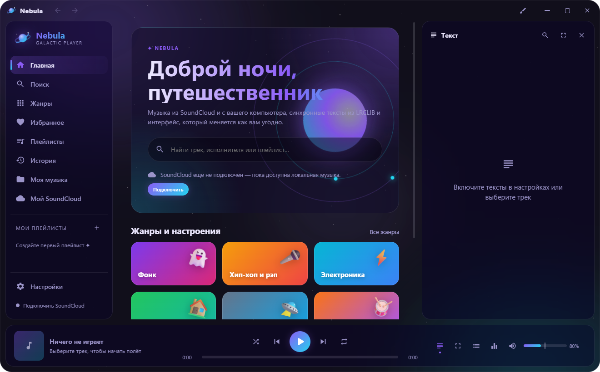
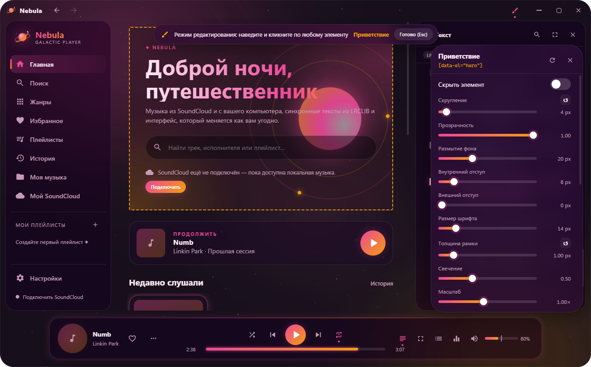

# Nebula — галактический музыкальный плеер на Rust

SoundCloud и локальная музыка, синхронные тексты из [LRCLIB](https://lrclib.net),
стеклянный «космический» интерфейс, в котором можно менять всё: темы, раскладку,
каждый элемент по отдельности и свой CSS.



## Возможности

**Звук**
- Собственный движок: symphonia (MP3, AAC/M4A, FLAC, WAV, OGG Vorbis, AIFF) → ресемплинг → вывод через WASAPI (cpal).
- Громкость до **200%** (максимум настраивается до 400%) с мягким пиковым лимитером: усиление без хрипа.
- 10-полосный эквалайзер, 11 пресетов (включая «Космос»), предусиление, баланс, моно.
- Плавное затухание при паузе и перемотке, выбор устройства вывода, автопереключение при смене устройства в Windows.
- HLS-клиент для SoundCloud: AAC (fMP4/CMAF), MP3, MPEG-TS, `EXT-X-BYTERANGE`; ленивая подгрузка сегментов в окне «буфер вперёд», мгновенная перемотка, предзагрузка следующего трека.

**Тексты (LRCLIB)**
- Синхронный текст сбоку (слева или справа) или на весь экран с размытой обложкой.
- Караоке-заливка строки, размытие неактивных строк, автопрокрутка (пауза, когда листаете сами), клик по строке — перемотка.
- Умный поиск по «грязным» названиям SoundCloud, ручной выбор текста, сдвиг тайминга для каждого трека, кэш на диске.

**Музыка**
- SoundCloud **без входа**: поиск, жанры, исполнители, плейлисты, похожие треки и прослушивание работают сразу (гостевой режим через API сайта). Вход через страницу SoundCloud в панели Nebula или официальный OAuth нужен только для лайков, ленты и своих плейлистов. Поиск треков, плейлистов и исполнителей, 24 жанра, похожие треки, страницы исполнителей и плейлистов, автовоспроизведение похожих после очереди.
- Ваши лайки, лента подписок и плейлисты SoundCloud.
- YouTube через [yt-dlp](https://github.com/yt-dlp/yt-dlp): поиск во вкладке «YouTube», а 30-секундные превью и недоступные в регионе треки SoundCloud автоматически играют полной версией с YouTube (подбор по названию и длительности). yt-dlp скачивается сам при первом обращении и обновляется раз в неделю; свою копию можно положить рядом с `Nebula.exe`.
- Импорт публичных плейлистов Яндекс Музыки по ссылке с сопоставлением к локальным файлам и SoundCloud.
- Локальная библиотека: папки с музыкой, теги и обложки (lofty), инкрементальное сканирование.
- Избранное, история, свои плейлисты, очередь (перемешивание, повтор, «играть следующим»), восстановление сессии.
- На главной — время фактического прослушивания и самый часто прослушанный трек.

**Интерфейс**
- 9 встроенных тем: Чёрная (по умолчанию), Галактика, Туманность Ориона, Северное сияние, Сверхновая, Чёрная дыра, Синтвейв, Чистое стекло, Лунный свет.
- Меню разделов — док со значками в верхней панели: при наведении значок пружинисто увеличивается, покачивается и показывает подпись, соседние значки тоже слегка растут.
- Редактор тем: цвета, скругления, стекло (размытие, плотность, свечение), прозрачность окна, шрифт; фон — звёзды и туманности, градиент, цвет, картинка/**GIF**, **видео** или размытая обложка.
- Верхний мини-плеер «островок»: компактная обложка и трек раскрываются наведением в панель с перемоткой и управлением.
- Discord Rich Presence: текущий трек и состояние плеера можно показывать в профиле Discord.
- Раскладка: меню сверху (док) или слева/справа, плеер снизу/сверху/парящий, вид плеера, порядок и видимость кнопок, пунктов меню и разделов главной, форма обложки (в т. ч. крутящийся винил), плотность списков.
- **Режим редактирования** (кисть в заголовке или `Ctrl+E`): кликните по любому элементу — инспектор позволяет менять скругление, фон, прозрачность, размытие, отступы, шрифт, рамку, свечение, масштаб, смещение, порядок и задать свой CSS.
- Анимации открытия, закрытия и сворачивания окна, переходов страниц и панелей; полупрозрачное окно, эффекты Windows 11 (Mica/Acrylic/Blur).
- Экспорт и импорт тем в JSON, цвет акцента из обложки, пульсация обложки в такт басу.



## Сборка и запуск

Нужны Windows 10/11 (WebView2 уже есть в Windows 11) и Rust. Проект собирается тулчейном
`x86_64-pc-windows-gnu` без Visual Studio.

Один раз настройте линковку (компонент `llvm-tools` и `.cargo/config.toml`):

```bash
powershell -ExecutionPolicy Bypass -File scripts\setup-gnu.ps1
```

Запуск для разработки:

```bash
cargo run
```

Оптимизированная сборка в `dist\Nebula` (exe + `WebView2Loader.dll`, которая должна лежать рядом с exe):

```bash
powershell -ExecutionPolicy Bypass -File scripts\build-release.ps1
```

На тулчейне MSVC (с Visual Studio Build Tools) настройка не нужна: удалите `.cargo/config.toml`
и соберите обычным `cargo build --release`. WebView2Loader в этом случае линкуется статически.

## Вход в SoundCloud

Нажмите **«Войти через SoundCloud»** (на главной, в «Мой SoundCloud» или в **Настройки → SoundCloud**).
Откроется отдельное окно со страницей SoundCloud: войдите по паролю, через Google или Apple.
После входа окно закроется, а Nebula получит токен сессии сайта.

- Токен сессии хранится локально (`%APPDATA%\NebulaPlayer\soundcloud.json`).
- «Выйти» забывает токен и очищает профиль окна входа. Если SoundCloud отзовёт сессию, Nebula покажет «Войдите снова».

**Свои ключи API (для разработчиков).** Можно работать и через официальный API: создайте приложение на
[soundcloud.com/you/apps](https://soundcloud.com/you/apps) (по документации SoundCloud для этого нужна
подписка Artist Pro), укажите Redirect URI `http://127.0.0.1:47823/callback` и вставьте Client ID и
Client Secret в блок «Свои ключи API» в **Настройки → SoundCloud**. Если выполнен вход через сайт,
используется он. Без входа работают локальная музыка, тексты и весь интерфейс.

## Горячие клавиши

| Клавиша | Действие |
| --- | --- |
| Пробел | Пауза / воспроизведение |
| ← / → | Перемотка (шаг настраивается) |
| Ctrl + ← / → | Предыдущий / следующий трек |
| ↑ / ↓ | Громкость |
| M / S / R | Без звука / перемешивание / повтор |
| L / F / Q | Текст сбоку / на весь экран / очередь |
| F11 | Полноэкранное окно |
| Ctrl + F или / | Поиск |
| Ctrl + E | Режим редактирования |
| Esc | Закрыть панель, окно или режим |
| Медиаклавиши | Работают и в фоне |

## Свой CSS

Каждый элемент помечен атрибутом `data-el`, все цвета и размеры доступны как переменные:

```css
[data-el="player"] { border-radius: 0; }
[data-el="lyrics_active"] { letter-spacing: 1px; }
.track-row:hover { transform: translateX(4px); }
:root { --accent: #ff7ad9; }
```

В инспекторе элемента символ `&` означает сам элемент: `& img { filter: grayscale(1) }`.

## Устройство

| Модуль | Что делает |
| --- | --- |
| `src/audio` | Загрузка (файл/HTTP/HLS), демультиплексор TS, декодер, ресемплер, DSP, вывод cpal, контроллер плеера |
| `src/soundcloud.rs` | Веб-сессия SoundCloud и OAuth 2.1 (client credentials, Authorization Code + PKCE), каталог, лайки, лента и потоки |
| `src/sc_login.rs` | Окно входа SoundCloud с отдельным профилем WebView2 |
| `src/yandex.rs` | Импорт публичных плейлистов Яндекс Музыки и сопоставление треков |
| `src/discord.rs` | Необязательный Discord Rich Presence через локальный IPC |
| `src/lyrics.rs` | LRCLIB, разбор LRC, очистка названий, выбор кандидата, кэш |
| `src/media.rs` | `/media/*` внутри WebView: дисковый кэш обложек (LRU по размеру), локальные обложки, фоны с Range |
| `src/theme.rs` | Темы, раскладка, стили элементов → CSS-переменные и правила |
| `src/ui` | Компоненты Dioxus: каркас, страницы, плеер, тексты, настройки, редактор тем, инспектор |

**Нагрузка на CPU**
- Аудиоколбэк реального времени не выделяет память и не блокируется: lock-free кольцевой буфер (rtrb), параметры DSP читаются через `try_lock` только при изменении.
- UI перерисовывает только то, что поменялось: позиция трека обновляет лишь полосу прогресса (4 раза в секунду) и активную строку текста.
- Фоновые анимации (звёзды, туманности, винил) идут только через `transform` и `opacity` на GPU-композиторе. Они замирают, когда окно неактивно, а экономный режим их упрощает.
- Обложки грузятся лениво (`loading=lazy`) и кэшируются на диске, тексты кэшируются, следующий трек предзагружается.
- Release-профиль: `lto = "fat"`, `codegen-units = 1`, `opt-level = 3`.

## Тесты

```bash
cargo test
```

Сквозные тесты движка на реальном звуковом устройстве (громкость 0, нужен интернет — публичные тестовые потоки Apple):

```bash
cargo test live_ -- --ignored --nocapture
```

## Ограничения

- Потоки Opus и защищённые DRM потоки SoundCloud не поддерживаются (AAC и MP3 работают).
- Треки с ограничениями правообладателя SoundCloud отдаёт только как 30-секундное превью — Nebula их помечает.
- Публичные плейлисты Яндекс Музыки импортируются через внутренний endpoint сайта; приватные ссылки и
  стабильный импорт часов прослушивания сервис официально не предоставляет. Если API возвращает
  `401/451`, в форме импорта можно указать OAuth-токен своей сессии; он хранится локально в `yandex.json`.
- Локальный счётчик времени на главной считает фактически проигранные секунды в Nebula.
- Для Discord RPC укажите Application ID своего приложения Discord Developer Portal в
  **Настройки → Интерфейс → Discord Rich Presence**.
- Медиаклавиши работают, а плашки «Сейчас играет» в системном оверлее Windows пока нет.
